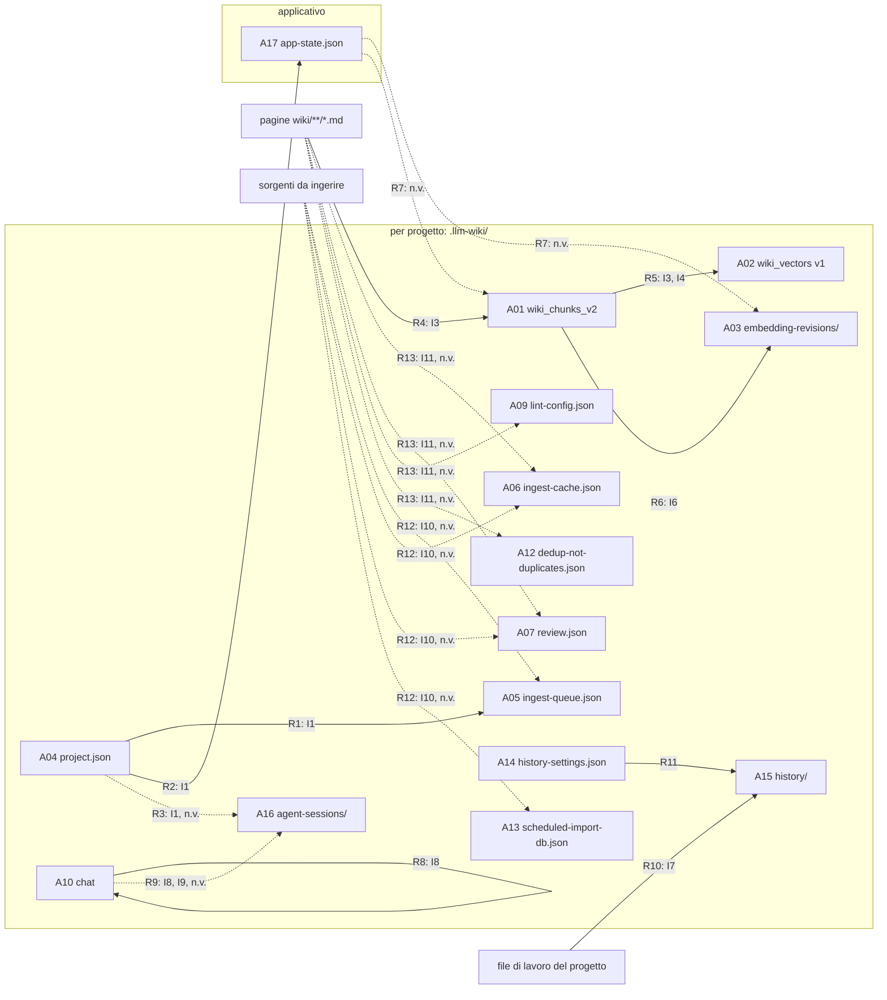

# Indice degli schemi — layer di persistenza di llm-wiki

> Indice degli archivi su file di llm-wiki (16 per progetto più lo store applicativo), con posizione, scrittore, lettore e stato di documentazione, gli identificatori con la loro derivazione e le relazioni fra archivi. I punti non noti sono marcati e rimandano al gap.

## Perimetro

L'indice documenta lo stato attuale degli archivi, come risulta dalla wiki alla data di `wiki_snapshot`. Non propone interventi sul codice e non anticipa i dettagli di schema, che stanno nelle schede di US-020..US-024 (sezione «Schede di dettaglio»). L'unità di conteggio è la riga della tabella di inventario della wiki: 17 righe, cioè 16 archivi per progetto più lo store applicativo (decisione dell'utente del 2026-11-20, vedi «Discrepanze note»). [^src: management/kanban/EP-003-schemi-attuali-layer-persistenza/US-019-indice-db-schemas-e-relazioni/US-019.md §Business Rules]

## Convenzioni

La norma è in ADR-EP003-001; qui solo la sintesi operativa.

- **Numeri stabili**: `A01..` per gli archivi (ordine della tabella di inventario della wiki), `X01..` per i candidati fuori inventario, `I1..` per gli identificatori, `R1..` per le relazioni. Non si riassegnano.
- **Stato derivato**: `documentato` se la riga non ha marcatori; `parziale` se ne ha almeno uno; `non verificato` se l'esistenza stessa come archivio non è stabilita (solo righe `X`). Lo stato è scritto in chiaro.
- **Marcatore**: la dicitura «non verificato» in grassetto seguita da `[gap: <slug>]` con lo slug di un gap presente in `wiki/gaps.md`; sintassi e regex in ADR-EP003-001 §D. Nel diagramma l'abbreviazione `n.v.` è ammessa solo su archi tratteggiati coperti da una riga `R`.
- **Fonte**: forma breve nella cella, citazione completa nel blocco «Fonti della tabella» sotto ogni tabella. Si citano solo storie.

## Archivi

Preambolo, valido per tutte le righe con ambito `progetto`:

- `create_project` non crea `.llm-wiki/` e `open_project` non la richiede; chi crea la cartella per un progetto importato o aperto da disco: **non verificato** [gap: llm-wiki-creazione-cartella-dati]. [^src: management/kanban/EP-002-conoscenza-layer-di-persistenza/US-014-store-applicativo-e-area-dati/US-014.md §Fonti]
- Scrittori e lettori sono quelli osservati nel campione di codice letto; altri scrittori o lettori nel codice non letto: **non verificato** [gap: llm-wiki-persistenza-codice-non-letto]. [^src: management/kanban/EP-002-conoscenza-layer-di-persistenza/US-013-estrazione-mirata-persistenza/US-013.md §Fonti]

Nelle colonne Scrittore e Lettore, «TS» indica il frontend TypeScript, «RS» il backend Rust. Le posizioni con ambito `progetto` sono relative alla cartella del progetto.

| # | Archivio | Posizione (ambito) | Scrittore | Lettore | Stato | Scheda | Fonte |
|---|---|---|---|---|---|---|---|
| A01 | Tabella LanceDB v2 `wiki_chunks_v2` | `.llm-wiki/lancedb` (progetto) | RS (`vectorstore.rs`), su comandi invocati da TS (`embedding.ts`) e da RS (`page_embedding.rs`) | RS (`vectorstore.rs`), su comandi invocati da TS (`embedding.ts`) e da RS (`page_embedding.rs`) | parziale; schema multimodale **non verificato** [gap: llm-wiki-multimodale-stato]; coerenza della dimensione del vettore al cambio di modello **non verificato** [gap: llm-wiki-embedding-cambio-modello] | `vettoriali.md` (US-020, da scrivere) | US-019 §Fonti; US-020 §Business Rules; US-031 §Fonti |
| A02 | Tabella LanceDB v1 `wiki_vectors` (legacy) | `.llm-wiki/lancedb` (progetto) | RS (`vector_upsert`, ancora presente); chiamanti **non verificato** [gap: llm-wiki-vector-v1-chiamanti] | RS; TS solo conteggio e drop | parziale | `vettoriali.md` (US-020, da scrivere) | US-019 §Fonti; US-016 §Fonti |
| A03 | Revisioni embedding | `.llm-wiki/embedding-revisions/<sha256(page_id)>.revision` (progetto) | RS (file temporaneo e rinomina) | RS; TS non lo usa | documentato | `vettoriali.md` (US-020, da scrivere) | US-019 §Fonti |
| A04 | `project.json` | `.llm-wiki/project.json` (progetto) | TS (`project-identity.ts`) | TS (`project-identity.ts`); RS non lo legge | documentato | `archivi-progetto.md` (US-021, da scrivere) | US-019 §Fonti |
| A05 | `ingest-queue.json` | `.llm-wiki/ingest-queue.json` (progetto) | TS (`ingest-queue.ts`) | TS (`ingest-queue.ts`) | documentato | `archivi-progetto.md` (US-021, da scrivere) | US-019 §Fonti |
| A06 | `ingest-cache.json` | `.llm-wiki/ingest-cache.json` (progetto) | TS (`ingest-cache.ts`); scrittura da `ingest.ts` **non verificato** [gap: llm-wiki-persistenza-codice-non-letto] | TS (`ingest-cache.ts`) | parziale | `archivi-progetto.md` (US-021, da scrivere) | US-019 §Fonti; US-013 §Fonti |
| A07 | `review.json` | `.llm-wiki/review.json` (progetto) | TS (`persist.ts`, `review-store.ts`) | TS (`persist.ts`, `review-store.ts`) | documentato | `archivi-progetto.md` (US-021, da scrivere) | US-019 §Fonti |
| A08 | `lint.json` | `.llm-wiki/lint.json` (progetto) | TS (`persist.ts`) | TS (`persist.ts`) | parziale; tipo degli elementi (`LintItem`, definito in `lint-store.ts`) **non verificato** [gap: llm-wiki-persistenza-codice-non-letto] | `archivi-progetto.md` (US-021, da scrivere) | US-019 §Fonti; US-021 §Business Rules |
| A09 | `lint-config.json` | `.llm-wiki/lint-config.json` (progetto) | TS (`lint-config.ts`), scrittura atomica | TS (`lint-config.ts`) | documentato | `archivi-progetto.md` (US-021, da scrivere) | US-019 §Fonti |
| A10 | Chat | `.llm-wiki/conversations.json` e `.llm-wiki/chats/<id>.json` (progetto) | TS (`persist.ts`, `chat-store.ts`); rimozione fisica dei file `chats/<id>.json` **non verificato** [gap: llm-wiki-persistenza-codice-non-letto] | TS (`persist.ts`, `chat-store.ts`) | parziale | `chat-sessioni-cronologia.md` (US-022, da scrivere) | US-019 §Fonti; US-019 §UI Reference; US-013 §Fonti |
| A11 | `chat-preferences.json` | `.llm-wiki/chat-preferences.json` (progetto) | TS (`persist.ts`) | TS (`persist.ts`) | documentato | `archivi-progetto.md` (US-021, da scrivere) | US-019 §Fonti |
| A12 | `dedup-not-duplicates.json` | `.llm-wiki/dedup-not-duplicates.json` (progetto) | TS (`dedup-storage.ts`) | TS (`dedup-storage.ts`) | documentato | `archivi-progetto.md` (US-021, da scrivere) | US-019 §Fonti |
| A13 | `scheduled-import-db.json` | `.llm-wiki/scheduled-import-db.json` (progetto) | TS (`scheduled-import.ts`), scrittura atomica | TS (`scheduled-import.ts`) | documentato | `archivi-progetto.md` (US-021, da scrivere) | US-019 §Fonti |
| A14 | `history-settings.json` | `.llm-wiki/history-settings.json` (progetto) | RS (`file_history.rs`) | RS (`file_history.rs`) | documentato | `archivi-progetto.md` (US-021, da scrivere) | US-019 §Fonti |
| A15 | Cronologia file | `.llm-wiki/history/<hash FNV-1a a 64 bit del percorso relativo>.json` (progetto) | RS; TS tramite comandi | RS; TS tramite comandi | documentato | `chat-sessioni-cronologia.md` (US-022, da scrivere) | US-019 §Fonti |
| A16 | Sessioni agente | `.llm-wiki/agent-sessions/<id>.json` (progetto) | RS (`agent/session.rs`); chiamanti in `agent/runtime.rs` **non verificato** [gap: llm-wiki-persistenza-codice-non-letto] | RS (`agent/session.rs`) | parziale | `chat-sessioni-cronologia.md` (US-022, da scrivere) | US-019 §Fonti; US-013 §Fonti |
| A17 | `app-state.json` | Store del plugin Tauri nella cartella dati dell'app (applicativo); percorso **non verificato** [gap: llm-wiki-app-state-percorso] | TS, quasi tutte le chiavi (`project-store.ts`, `project-identity.ts`); il resto **non verificato** [gap: llm-wiki-persistenza-codice-non-letto] | TS; RS legge `proxyConfig` e `apiConfig` (dai commenti di `project-store.ts`: `apiConfig` a ogni richiesta, con cache di 5 secondi) | parziale; comportamento del plugin su file corrotto **non verificato** [gap: llm-wiki-app-state-percorso] | `store-applicativo.md` (US-023, da scrivere) | US-019 §Fonti; US-023 §Business Rules; US-014 §Fonti |

Fonti della tabella:
- US-019 §Fonti: [^src: management/kanban/EP-003-schemi-attuali-layer-persistenza/US-019-indice-db-schemas-e-relazioni/US-019.md §Fonti]
- US-019 §UI Reference: [^src: management/kanban/EP-003-schemi-attuali-layer-persistenza/US-019-indice-db-schemas-e-relazioni/US-019.md §UI Reference]
- US-020 §Business Rules: [^src: management/kanban/EP-003-schemi-attuali-layer-persistenza/US-020-schema-archivi-vettoriali/US-020.md §Business Rules]
- US-021 §Business Rules: [^src: management/kanban/EP-003-schemi-attuali-layer-persistenza/US-021-schema-archivi-per-progetto/US-021.md §Business Rules]
- US-023 §Business Rules: [^src: management/kanban/EP-003-schemi-attuali-layer-persistenza/US-023-schema-store-applicativo/US-023.md §Business Rules]
- US-013 §Fonti: [^src: management/kanban/EP-002-conoscenza-layer-di-persistenza/US-013-estrazione-mirata-persistenza/US-013.md §Fonti]
- US-014 §Fonti: [^src: management/kanban/EP-002-conoscenza-layer-di-persistenza/US-014-store-applicativo-e-area-dati/US-014.md §Fonti]
- US-016 §Fonti: [^src: management/kanban/EP-002-conoscenza-layer-di-persistenza/US-016-chiamanti-operazioni-distruttive/US-016.md §Fonti]
- US-031 §Fonti: [^src: management/kanban/EP-004-verifica-rischi-di-persistenza/US-031-rischio-cambio-modello-embedding/US-031.md §Fonti]

Riepilogo: 17 archivi, di cui 10 `documentato` (A03, A04, A05, A07, A09, A11, A12, A13, A14, A15) e 7 `parziale` (A01, A02, A06, A08, A10, A16, A17).

## Fuori inventario

File e cartelle citati in wiki ma assenti dalla tabella di inventario. Non sono conteggiati fra i 17.

| # | Candidato | Posizione | Stato | Nota | Fonte |
|---|---|---|---|---|---|
| X01 | `image-caption-cache.json` | non riportata, **non verificato** [gap: llm-wiki-file-citati-non-verificati] | non verificato | Citato nei commenti del codice; possibile coincidenza con la «cache delle didascalie» scritta da `ingest.ts`, **non verificato** [gap: llm-wiki-persistenza-codice-non-letto] | US-015 §Fonti; US-013 §Fonti |
| X02 | `lexical-graph.json` | non riportata, **non verificato** [gap: llm-wiki-file-citati-non-verificati] | non verificato | Citato in un commento di `dedup-storage.ts` | US-015 §Fonti |
| X03 | Cartella `raw/sources/.cache` | `raw/sources/.cache` (progetto, fuori da `.llm-wiki/`) | non verificato | Esistenza come archivio **non verificato** [gap: llm-wiki-file-citati-non-verificati] | US-015 §Fonti |
| X04 | Cartella legacy `.llm-wiki-imported` | non riportata, **non verificato** [gap: llm-wiki-file-citati-non-verificati] | non verificato | Resta un riferimento nel codice dello scheduled import | US-015 §Fonti; US-024 §Fonti |
| X05 | `chat-history.json` (formato legacy della chat) | non riportata, **non verificato** [gap: llm-wiki-archivi-sommario-conteggi] | parziale | Letto da `loadChatHistory` dopo il formato corrente e la ricostruzione dai file orfani, in due forme: array piatto, migrato nella conversazione `default` «Previous Conversations», oppure oggetto combinato. Dal campione non risulta che venga riscritto nel formato nuovo né cancellato | US-024 §Fonti; US-024 §Business Rules |
| X06 | Stato eventualmente persistito da `dedup-queue.ts` (coda dedup) e da `src-tauri/src/commands/file_sync.rs` | non riportata, **non verificato** [gap: llm-wiki-persistenza-codice-non-letto] | non verificato | Il codice non è letto: non si sa se questi moduli persistano stato | US-013 §Fonti |

X05 ha stato `parziale` e non `non verificato`: che il codice legga il formato è documentato, la posizione no.

Fonti della tabella:
- US-013 §Fonti: [^src: management/kanban/EP-002-conoscenza-layer-di-persistenza/US-013-estrazione-mirata-persistenza/US-013.md §Fonti]
- US-015 §Fonti: [^src: management/kanban/EP-002-conoscenza-layer-di-persistenza/US-015-atomicita-scritture-e-sync-file/US-015.md §Fonti]
- US-024 §Fonti: [^src: management/kanban/EP-003-schemi-attuali-layer-persistenza/US-024-versioni-formato-compatibilita/US-024.md §Fonti]
- US-024 §Business Rules: [^src: management/kanban/EP-003-schemi-attuali-layer-persistenza/US-024-versioni-formato-compatibilita/US-024.md §Business Rules]

## Identificatori

| # | Identificatore | Forma e derivazione | Generato da | Usato in | Stato | Fonte |
|---|---|---|---|---|---|---|
| I1 | Id progetto | UUID nel campo `id` di `project.json`, con `createdAt` (ms); se il file manca o è corrotto si genera un nuovo UUID e si sovrascrive il file | TS `ensureProjectId` (`project-identity.ts`) | A04; A05 (`projectId` dei task); A17 (`projectRegistry`, `recentProjects`, `lastProject`, chiavi per progetto); A16 (`projectId`), corrispondenza con l'`id` di A04 **non verificato** [gap: llm-wiki-id-chat-sessione, llm-wiki-persistenza-codice-non-letto] | parziale | US-019 §UI Reference; US-021 §Acceptance Criteria |
| I2 | Percorso del progetto | Campo `path` delle voci di `recentProjects`, `lastProject` e `projectRegistry`; suffisso della chiave `scheduledImportConfig:<percorso>`; forma del percorso **non verificato** [gap: llm-wiki-riferimenti-incrociati] | Percorso della cartella del progetto su disco | A17 | parziale | US-023 §Fonti |
| I3 | Id pagina (formato corrente, v2) | Percorso relativo sotto `wiki/` senza `.md`; validato: massimo 256 caratteri, niente apici, barre inverse, caratteri di controllo o invisibili, perché entra in un filtro testuale | TS `wikiPageIdFromPath` (`embedding.ts`), RS `vector_page_id` (`page_embedding.rs`) | A01 (`page_id`); base di I5 e I6 | documentato | US-019 §Fonti; US-020 §Business Rules |
| I4 | Id pagina legacy (v1) | Nome base del file della pagina; una riga per pagina | Derivato dal nome del file nella scrittura v1 | A02 (`page_id`) | documentato | US-019 §Fonti; US-024 §Acceptance Criteria |
| I5 | `chunk_id` | `page_id` + `#` + `chunk_index`; usato solo per debug | RS, scrittura v2 | A01 | documentato | US-019 §Fonti |
| I6 | Nome del file di revisione | `sha256(page_id)` con estensione `.revision`, in `embedding-revisions/`; codifica dell'hash nel nome **non verificato** [gap: llm-wiki-riferimenti-incrociati] | RS | A03 | parziale | US-019 §Fonti; US-020 §Acceptance Criteria |
| I7 | Nome del file di cronologia | Hash FNV-1a a 64 bit, con costanti fisse, del percorso relativo, con estensione `.json`, in `history/`; i file sotto `.llm-wiki` non sono registrati; base del percorso relativo e codifica dell'hash **non verificato** [gap: llm-wiki-riferimenti-incrociati] | RS (`file_history.rs`) | A15 (nome del file; campo `path` delle voci) | parziale | US-019 §Fonti; US-022 §Business Rules |
| I8 | Id conversazione | Campo `id` della conversazione = nome del file `chats/<id>.json` = `conversationId` dei messaggi; `default` per la conversazione migrata dal formato legacy; generazione **non verificato** [gap: llm-wiki-id-chat-sessione] | **non verificato** [gap: llm-wiki-id-chat-sessione] | A10; X05 | parziale | US-019 §Fonti; US-024 §Fonti |
| I9 | Id sessione agente | Campo `sessionId` = nome del file `agent-sessions/<id>.json`; l'id viene sanitizzato, con regola **non verificato** [gap: llm-wiki-id-chat-sessione]; valore di default per i file vecchi | **non verificato** [gap: llm-wiki-id-chat-sessione, llm-wiki-persistenza-codice-non-letto] | A16 | parziale | US-019 §Fonti; US-022 §Business Rules |
| I10 | Riferimento a sorgente | `sourcePath` (relativo) nei task di A05; «nome sorgente» come chiave di `entries` in A06; percorsi in `files` di A13, sotto la directory indicizzata per percorso normalizzato; `sourcePath` opzionale in A07; equivalenza fra le forme **non verificato** [gap: llm-wiki-riferimenti-incrociati] | Per archivio, vedi Forma | A05, A06, A07, A13 | parziale | US-019 §Fonti |
| I11 | Riferimenti a pagina negli altri archivi | `filesWritten[]` in A06; `affectedPages` opzionale in A07; `ignorePages[]` in A09; gruppi di slug in A12; relazione con I3 **non verificato** [gap: llm-wiki-riferimenti-incrociati] | Per archivio, vedi Forma | A06, A07, A09, A12 | parziale | US-019 §Fonti |

Gli identificatori interni a un solo archivio (ad esempio l'id dei task della coda o l'id delle review) non sono qui: stanno nelle schede.

Fonti della tabella:
- US-019 §Fonti: [^src: management/kanban/EP-003-schemi-attuali-layer-persistenza/US-019-indice-db-schemas-e-relazioni/US-019.md §Fonti]
- US-019 §UI Reference: [^src: management/kanban/EP-003-schemi-attuali-layer-persistenza/US-019-indice-db-schemas-e-relazioni/US-019.md §UI Reference]
- US-020 §Business Rules: [^src: management/kanban/EP-003-schemi-attuali-layer-persistenza/US-020-schema-archivi-vettoriali/US-020.md §Business Rules]
- US-020 §Acceptance Criteria: [^src: management/kanban/EP-003-schemi-attuali-layer-persistenza/US-020-schema-archivi-vettoriali/US-020.md §Acceptance Criteria]
- US-021 §Acceptance Criteria: [^src: management/kanban/EP-003-schemi-attuali-layer-persistenza/US-021-schema-archivi-per-progetto/US-021.md §Acceptance Criteria]
- US-022 §Business Rules: [^src: management/kanban/EP-003-schemi-attuali-layer-persistenza/US-022-schema-chat-sessioni-cronologia/US-022.md §Business Rules]
- US-023 §Fonti: [^src: management/kanban/EP-003-schemi-attuali-layer-persistenza/US-023-schema-store-applicativo/US-023.md §Fonti]
- US-024 §Fonti: [^src: management/kanban/EP-003-schemi-attuali-layer-persistenza/US-024-versioni-formato-compatibilita/US-024.md §Fonti]
- US-024 §Acceptance Criteria: [^src: management/kanban/EP-003-schemi-attuali-layer-persistenza/US-024-versioni-formato-compatibilita/US-024.md §Acceptance Criteria]

## Relazioni

«Da» è l'archivio, o l'entità esterna, che definisce l'identificatore; «A» è chi lo usa. Le conseguenze sui rischi non sono qui: stanno nelle storie di EP-004.

| # | Da | A | Via | Regola | Stato | Fonte |
|---|---|---|---|---|---|---|
| R1 | A04 (`id`) | A05 (`projectId` dei task) | I1 | `restoreQueue` scarta come «cross-project» i task con un id diverso da quello del progetto; `loadQueue` assegna ai task senza `projectId` quello del progetto aperto | documentato | US-019 §UI Reference; US-024 §Fonti |
| R2 | A04 (`id`) | A17 (`projectRegistry` per id; `id` di `recentProjects` e `lastProject`; `projectLlmOverrides`, `projectOutputLanguages`, `sourceWatchConfig`, `projectFileSyncEnabled`) | I1 | Impostazioni per progetto indicizzate per id progetto (vedi D5); convivenza con la chiave `default` di `sourceWatchConfig` e `projectFileSyncEnabled` **non verificato** [gap: llm-wiki-riferimenti-incrociati] | parziale | US-019 §UI Reference; US-023 §Fonti |
| R3 | A04 (`id`) | A16 (`projectId`) | I1 | Corrispondenza fra i due valori **non verificato** [gap: llm-wiki-id-chat-sessione, llm-wiki-persistenza-codice-non-letto] | non verificato | US-019 §Fonti |
| R4 | Pagine `wiki/**/*.md` | A01 (`page_id`) | I3 | Una riga per chunk di pagina (`chunk_index`), fino a 512 chunk per pagina | documentato | US-019 §Fonti; US-020 §Business Rules |
| R5 | A01 (`page_id`, I3) | A02 (`page_id`, I4) | I3, I4 | `removeLegacyVectorIdIfSafe` (in TS e in RS) elimina le righe v1 con id «nome base» solo se esiste esattamente una pagina con quel nome; il re-index elimina poi la tabella v1 in modalità best effort | documentato | US-019 §Fonti; US-024 §Business Rules |
| R6 | A01 (`page_id`) | A03 (nome del file) | I6 | Un file di revisione per id di pagina; un upsert di chunk senza impronta, ad esempio dal percorso TS, invalida la revisione salvata | documentato | US-019 §Fonti; US-019 §UI Reference |
| R7 | A17 (`embeddingConfig`) | A03 (impronta); A01 (dimensione di `vector`) | — | L'impronta include endpoint, modello, dimensione di uscita, intestazioni extra, dimensione e sovrapposizione dei chunk; la dimensione del vettore è fissata dal primo chunk di una scrittura; origine di questi valori e coerenza al cambio di modello **non verificato** [gap: llm-wiki-embedding-cambio-modello, llm-wiki-persistenza-codice-non-letto] | non verificato | US-020 §Business Rules; US-031 §Fonti |
| R8 | A10 (`conversations.json`) | A10 (`chats/<id>.json`) | I8 | Indice delle conversazioni più un file per conversazione; i messaggi portano `conversationId`; se l'indice manca o non si legge, viene ricostruito dai file della cartella `chats/` | documentato | US-019 §Fonti; US-022 §Business Rules |
| R9 | A10 | A16 | I8, I9 | Identificativo comune fra conversazione chat e sessione agente **non verificato** [gap: llm-wiki-id-chat-sessione] | non verificato | US-019 §Business Rules |
| R10 | File di lavoro del progetto | A15 | I7 | Un file di cronologia per percorso relativo; voci con `content` fino a 512 KB; i file sotto `.llm-wiki` non sono registrati; i symlink sono rifiutati | documentato | US-019 §Fonti; US-022 §Business Rules |
| R11 | A14 | A15 | — | `enabled` (default falso) e `maxVersionsPerFile` (default 10, massimo 30) governano la cronologia; il limite a 0 elimina la cartella `history/`; la riduzione del limite taglia le voci più vecchie | documentato | US-019 §Fonti; US-022 §Fonti |
| R12 | Sorgenti da ingerire | A05, A06, A07, A13 | I10 | Equivalenza fra le forme del riferimento a sorgente **non verificato** [gap: llm-wiki-riferimenti-incrociati] | non verificato | US-019 §Fonti |
| R13 | Pagine `wiki/**/*.md` (I3) | A06, A07, A09, A12 | I11 | Forma dei riferimenti a pagina rispetto all'id di pagina **non verificato** [gap: llm-wiki-riferimenti-incrociati] | non verificato | US-019 §Fonti |

Fonti della tabella:
- US-019 §Fonti: [^src: management/kanban/EP-003-schemi-attuali-layer-persistenza/US-019-indice-db-schemas-e-relazioni/US-019.md §Fonti]
- US-019 §UI Reference: [^src: management/kanban/EP-003-schemi-attuali-layer-persistenza/US-019-indice-db-schemas-e-relazioni/US-019.md §UI Reference]
- US-019 §Business Rules: [^src: management/kanban/EP-003-schemi-attuali-layer-persistenza/US-019-indice-db-schemas-e-relazioni/US-019.md §Business Rules]
- US-020 §Business Rules: [^src: management/kanban/EP-003-schemi-attuali-layer-persistenza/US-020-schema-archivi-vettoriali/US-020.md §Business Rules]
- US-022 §Business Rules: [^src: management/kanban/EP-003-schemi-attuali-layer-persistenza/US-022-schema-chat-sessioni-cronologia/US-022.md §Business Rules]
- US-022 §Fonti: [^src: management/kanban/EP-003-schemi-attuali-layer-persistenza/US-022-schema-chat-sessioni-cronologia/US-022.md §Fonti]
- US-023 §Fonti: [^src: management/kanban/EP-003-schemi-attuali-layer-persistenza/US-023-schema-store-applicativo/US-023.md §Fonti]
- US-024 §Fonti: [^src: management/kanban/EP-003-schemi-attuali-layer-persistenza/US-024-versioni-formato-compatibilita/US-024.md §Fonti]
- US-024 §Business Rules: [^src: management/kanban/EP-003-schemi-attuali-layer-persistenza/US-024-versioni-formato-compatibilita/US-024.md §Business Rules]
- US-031 §Fonti: [^src: management/kanban/EP-004-verifica-rischi-di-persistenza/US-031-rischio-cambio-modello-embedding/US-031.md §Fonti]

### Diagramma

Derivato dalla tabella delle relazioni, che fa fede. Linea continua: relazione `documentato` o `parziale`; tratteggiata con `n.v.`: relazione `non verificato`. A08 e A11 non compaiono perché la wiki non ne desume relazioni con altri archivi.

## Discrepanze note

Discrepanze fra pagine wiki, o fra wiki e kanban, trovate scrivendo l'indice. Non sono risolte qui. Decisione dell'utente del 2026-11-20: l'indice segue la tabella di inventario (16 per progetto più lo store); le discrepanze restano in questa sezione e nel gap sui conteggi; il product-manager allinea EP-003 e US-019 in un passaggio successivo.

- **D1, numero di archivi.** US-019 ed EP-003 parlano di «17 archivi dell'inventario più lo store applicativo»; la tabella di inventario a cui rimanda US-019 §Fonti ha 17 righe, con lo store compreso (16 per progetto). Si arriva a 17 per progetto solo contando la riga Chat come due file. Criterio di conteggio della wiki: **non verificato** [gap: llm-wiki-archivi-sommario-conteggi]. [^src: management/kanban/EP-003-schemi-attuali-layer-persistenza/US-019-indice-db-schemas-e-relazioni/US-019.md §Business Rules]
- **D2, versioni di formato esplicite.** La pagina dell'inventario, nel sommario e nella riga di `scheduled-import-db.json`, ne conta una; US-024 e le pagine su versioni e schema dati ne contano due (`version: 1` e il suffisso `_v2`). Numero delle versioni esplicite: **non verificato** [gap: llm-wiki-archivi-sommario-conteggi]. [^src: management/kanban/EP-003-schemi-attuali-layer-persistenza/US-024-versioni-formato-compatibilita/US-024.md §Business Rules]
- **D3, «hash del percorso».** US-019 (Business Rules) e US-022 (criterio 4) parlano di hash del percorso per revisioni e cronologia. Secondo l'inventario le revisioni usano `sha256(page_id)` e la cronologia l'hash FNV-1a a 64 bit del percorso relativo: algoritmi e input diversi. L'indice segue l'inventario (I6, I7). [^src: management/kanban/EP-003-schemi-attuali-layer-persistenza/US-022-schema-chat-sessioni-cronologia/US-022.md §Acceptance Criteria]
- **D4, scrittore della tabella v1.** L'inventario indica che RS scrive con `vector_upsert`; le pagine su versioni e operazioni distruttive dicono che nel campione `vector_upsert` non ha chiamanti. Scrittura effettiva del v1: **non verificato** [gap: llm-wiki-vector-v1-chiamanti]. [^src: management/kanban/EP-002-conoscenza-layer-di-persistenza/US-016-chiamanti-operazioni-distruttive/US-016.md §Business Rules]
- **D5, chiavi per progetto nello store.** La pagina sui rischi dice che `projectLlmOverrides`, `projectOutputLanguages`, `sourceWatchConfig` e `projectFileSyncEnabled` sono indicizzate per id progetto; la pagina dell'inventario dà a `sourceWatchConfig` e `projectFileSyncEnabled` una chiave `default`, mette `projectOutputLanguages` fra le impostazioni di interfaccia e indicizza `scheduledImportConfig:<percorso>` per percorso. Convivono due schemi di chiave, per id e per percorso (I1, I2); convivenza con la chiave `default`: **non verificato** [gap: llm-wiki-riferimenti-incrociati]. [^src: management/kanban/EP-003-schemi-attuali-layer-persistenza/US-023-schema-store-applicativo/US-023.md §Fonti]

## Schede di dettaglio

| File | Storia | Archivi | Stato |
|---|---|---|---|
| `vettoriali.md` | US-020 | A01, A02, A03 | da scrivere |
| `archivi-progetto.md` | US-021 | A04, A05, A06, A07, A08, A09, A11, A12, A13, A14 | da scrivere |
| `chat-sessioni-cronologia.md` | US-022 | A10, A15, A16 | da scrivere |
| `store-applicativo.md` | US-023 | A17 | da scrivere |
| `versioni-e-compatibilita.md` | US-024 | trasversale | da scrivere |

Ogni archivio appartiene a una sola scheda (3 + 10 + 3 + 1 = 17); gli archivi di US-021 sono quelli elencati nella sua descrizione. [^src: management/kanban/EP-003-schemi-attuali-layer-persistenza/US-021-schema-archivi-per-progetto/US-021.md §Descrizione]

US-020 e US-022 chiedono entrambe come si ricava il nome del file di revisione: la derivazione sta una volta sola in questo indice (I6, I7) e le due schede vi rimandano. [^src: management/kanban/EP-003-schemi-attuali-layer-persistenza/US-020-schema-archivi-vettoriali/US-020.md §Acceptance Criteria] [^src: management/kanban/EP-003-schemi-attuali-layer-persistenza/US-022-schema-chat-sessioni-cronologia/US-022.md §Acceptance Criteria]

## Contesto di lettura (non citazioni)

Pagine wiki da cui le storie citate ricavano i dati, utili per approfondire. Non sono fonti di questo indice: la fonte è sempre la storia.

- `llm-wiki-archivi-persistenza`: inventario, chiavi dello store, nota sulla cronologia
- `llm-wiki-schema-dati`: schema LanceDB, validazione dell'id di pagina, layout del progetto
- `llm-wiki-versioni-e-migrazioni`: identificatore di pagina, migrazioni in lettura
- `llm-wiki-operazioni-distruttive`: troncamenti, potature, cancellazioni
- `llm-wiki-gestione-file-corrotti`: comportamento su file illeggibile
- `llm-wiki-rischi-persistenza`: rischi dedotti dal codice
- `gaps`: gap citati nei marcatori

## Storico aggiornamenti

| Data | Modifica | Gap chiusi |
|---|---|---|
| 2026-11-20 | Prima stesura (TSK-010, ADR-EP003-001); `wiki_snapshot` 2026-11-20. Gli esiti dell'estrazione repo-sync in corso (store applicativo, area dati, tipi di configurazione) non sono ancora in wiki | nessuno |
